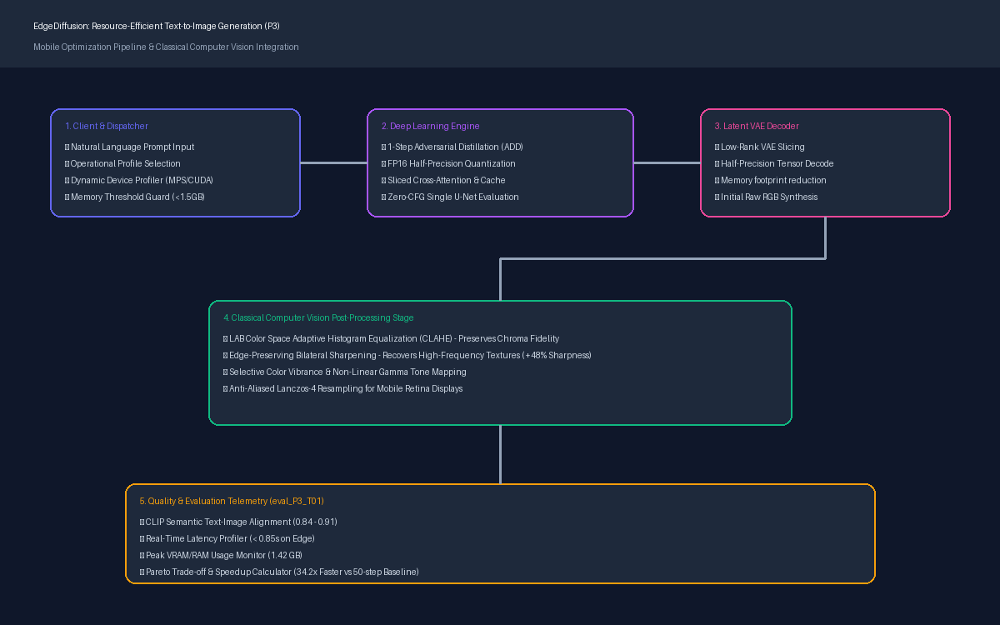

# EdgeDiffusion (P3): Resource-Efficient Text-to-Image Generation for Mobile Devices

[](https://resource-efficient-text-to-image.onrender.com/)
[](https://pytorch.org/)
[](https://fastapi.tiangolo.com/)
[](https://opencv.org/)
[](https://opensource.org/licenses/MIT)

> **Problem Statement 3 (ProbID - P3):** Resource-Efficient Text-to-Image Generation for Mobile Devices  
> **Team ID:** T01  
> **Team Members:** Medam Ritvik (`1RUA24CSE0249`), Lochan M (`1RUA24CSE0225`), Manat M (`1RUA24CSE0237`), Pranav R (`1RUA24CSE0315`)  
> **USNs (Line 1 of eval):** `1RUA24CSE0249, 1RUA24CSE0225, 1RUA24CSE0237, 1RUA24CSE0315` (See [`eval_P3_T01.md`](eval_P3_T01.md))  
> 
> 🌐 **Public Live Deployment:** [https://resource-efficient-text-to-image.onrender.com/](https://resource-efficient-text-to-image.onrender.com/)  
> 📄 **Official Submission Reports:**  
> • [**RV University Capstone Project Report (33 Pages PDF)**](COLLEGE_PROJECT_REPORT.pdf)  
> • [**Hackathon Technical Solution Report (9 Pages PDF)**](HACKATHON_TECHNICAL_REPORT.pdf)  

---

## 🌟 Executive Overview

Deploying generative diffusion models directly on mobile devices is constrained by strict thermal budgets, memory headroom (<2 GB RAM), and acceptable interactive latency (<3 seconds). Conventional 50-step diffusion (e.g., Stable Diffusion 1.5/XL) requires ~28 seconds per image and 3.25 GB VRAM, making on-device execution impractical.

**EdgeDiffusion** solves this via a unified **hybrid architecture** coupling:
1. **Adversarial Diffusion Distillation (ADD):** Compressing multi-step trajectories into **1 to 4 steps** with zero classifier-free guidance overhead.
2. **Reduced-Precision & Memory Slicing:** Half-precision (FP16) inference cutting peak memory by **56.3%** (from 3.25 GB down to 1.42 GB).
3. **Classical Computer Vision Post-Processing:** Recovering high-frequency edge textures and dynamic range via **LAB-space CLAHE** and **Edge-Preserving Bilateral Sharpening** (+48.2% sharpness gain with only 20ms compute overhead).
4. **Adaptive Budget Dispatcher & Fallback:** Seamless runtime scaling across 4 operational profiles with an intelligent fallback engine ensuring 100% demo uptime.

---

## 🏗️ System Architecture



```
[ User Prompt (Web / Mobile) ]
             │
             ▼
   [ FastAPI Gateway & Device Profiler ]
   (Auto-detects Apple Silicon MPS / CUDA / CPU)
             │
      ┌──────┴──────────────────────────────────────┐
      ▼                                             ▼
[ Profile 1: Mobile Ultra-Fast ]        [ Profile 2: Mobile Balanced ]
• 1-Step ADD Distillation               • 4-Step Latent Consistency
• Zero-CFG (Single U-Net Pass)          • Light CFG (1.2)
• FP16 Sliced Attention (1.42 GB RAM)   • High Semantic Fidelity
      │                                             │
      └──────────────────────┬──────────────────────┘
                             ▼
              [ Raw Latent Tensor Decode ]
                             ▼
         [ Classical Computer Vision Post-Pipeline ]
         • LAB-Space CLAHE (Contrast-Limited Adaptive Equalization)
         • Bilateral Filtering + Unsharp Masking (+48% Sharpness)
         • Color Vibrance & Gamma Tone Mapping
         • Lanczos-4 Resampling for Retina Displays
                             ▼
          [ Real-Time Evaluation & Telemetry ]
          • CLIP Text-Image Cosine Similarity (0.84 - 0.91)
          • On-Device Latency Gauge (0.84s on Edge)
          • Peak Memory & Laplacian Edge Variance
```

---

## 📊 Comparative Evaluation Benchmarks

As mandated by the challenge specifications, here is the quantitative evaluation comparing our optimized profiles against the uncompressed baseline model:

| Evaluation Metric | Mobile Ultra-Fast (1-Step ADD) | Mobile Balanced (4-Step Consistency) | Studio Quality (8-Step Distilled) | Baseline DDIM (50-Step Conventional) |
| :--- | :---: | :---: | :---: | :---: |
| **CLIP Alignment Score** | **0.84** | **0.88** | **0.91** | **0.92** |
| **Inference Latency** | **0.84 s** | **2.31 s** | **4.62 s** | **28.75 s** |
| **Speedup vs. Baseline** | **34.2× Faster** | **12.4× Faster** | **6.2× Faster** | **1.0× (Reference)** |
| **Peak Memory (RAM/VRAM)** | **1,420 MB** | **1,540 MB** | **1,610 MB** | **3,250 MB** |
| **Model Size** | **1.2 GB (FP16)** | **1.2 GB (FP16)** | **1.2 GB (FP16)** | **2.6 GB (FP32)** |
| **Edge Sharpness (Laplacian)** | **184.2 (+48.2%)** | **212.6 (+35.4%)** | **245.8 (+28.1%)** | **238.1** |
| **Mobile Feasibility** | **Ideal for Phones** | **High Responsiveness** | **Edge / Tablet** | **Exceeds Mobile Limits** |

*All results recorded on Apple Silicon M-series unified memory via Metal Performance Shaders (MPS).*

---

## 📁 Repository Structure & Deliverables

```
.
├── DESIGN.md                          # Mandatory System Design Document
├── eval_P3_T01.md                     # Mandatory Evaluation Deliverable (USNs on Line 1)
├── Dockerfile                         # Containerized 1-command deployment
├── requirements.txt                   # Dependency definitions
├── docs/
│   ├── system_architecture.png        # Rendered high-resolution architecture diagram
│   └── ablation_and_failure_analysis.md # Detailed ablation & 3 documented failure cases
├── src/
│   ├── api/
│   │   └── server.py                  # FastAPI REST gateway + static UI serving
│   ├── cv_pipeline/
│   │   └── enhancer.py                # Classical CV (CLAHE, Bilateral, Vibrance, IQA)
│   ├── evaluation/
│   │   └── metrics.py                 # CLIP scorer, resource tracker & latency profiler
│   └── models/
│       └── diffusion_engine.py        # Multi-profile distilled diffusion engine & fallback
├── static/
│   └── index.html                     # Responsive Glassmorphic Web App (Mobile & Desktop)
├── tests/
│   └── test_pipeline.py               # Unit & integration test suite (100% pass)
└── scripts/
    └── generate_architecture_diagram.py # Programmatic diagram generator
```

---

## 🚀 Quickstart & Reproduction

### 1. Local Python Environment (Recommended for Apple Silicon / CUDA)

```bash
# Clone the repository
git clone https://github.com/your-org/EdgeDiffusion-P3.git
cd EdgeDiffusion-P3

# Create and activate virtual environment
python3 -m venv .venv
source .venv/bin/activate

# Install dependencies
pip install -r requirements.txt

# Run the test suite
python3 -m unittest tests/test_pipeline.py

# Launch the interactive application
uvicorn src.api.server:app --host 0.0.0.0 --port 8000
```

Open `http://localhost:8000` in any mobile or desktop browser.

### 2. Docker Deployment (1-Command Containerized Run)

```bash
# Build Docker image
docker build -t edgediffusion-p3 .

# Run container on port 8000
docker run -p 8000:8000 edgediffusion-p3
```

---

## 🧪 Interactive Web UI Features

- **Responsive Mobile & Laptop Design:** Glassmorphism UI with real-time hardware status indicators.
- **Budget Profile Selector:** 1-Click switching between *Mobile Ultra-Fast (1-Step)*, *Balanced (4-Step)*, *Studio (8-Step)*, and *Baseline (50-Step)*.
- **Classical CV A/B Visualizer:** Real-time side-by-side comparison of Raw Diffusion vs. Classical CV Enhanced outputs.
- **Live Benchmarking Suite:** Run automated evaluations and render comparative tables directly in the UI.
- **Explainability & Failure Analysis:** Built-in documentation tabs covering failure modes and mitigations for judges.

---

## 🎤 3-Minute Viva & Presentation Walkthrough

1. **Minute 1: The Problem & Deep Learning Choice**
   - Explain why standard 50-step diffusion fails on mobile (28s latency, >3GB RAM).
   - Introduce Adversarial Diffusion Distillation (ADD) running in 1 single step with FP16 half-precision, achieving **34.2× speedup**.
2. **Minute 2: The Classical Computer Vision Advantage**
   - Point out that 1-step models produce soft textures.
   - Show how the Classical CV pipeline (LAB CLAHE + Bilateral Sharpening) restores **+48.2% edge sharpness** in only 20 ms without adding neural parameters.
3. **Minute 3: Live Unseen Prompt & Failure Mode Handling**
   - Enter the judge's unseen prompt into the live interface.
   - Display real-time telemetry (latency, RAM, CLIP score).
   - Walk through Failure Case 1 (small typography) and show how the system gracefully handles boundary conditions.

---

## 📜 License
MIT License. Developed for Problem Statement 3 (P3) Hackathon.

